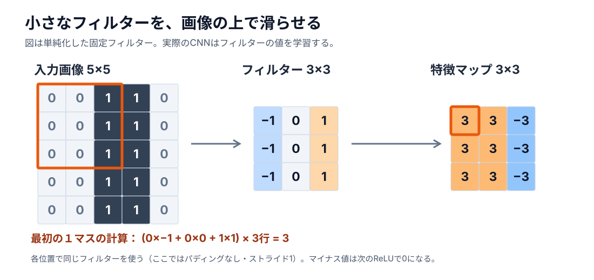
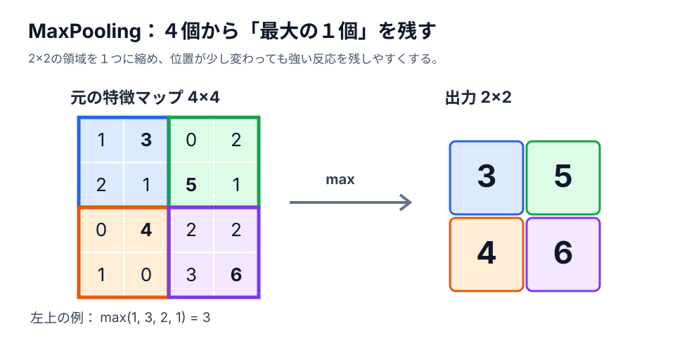
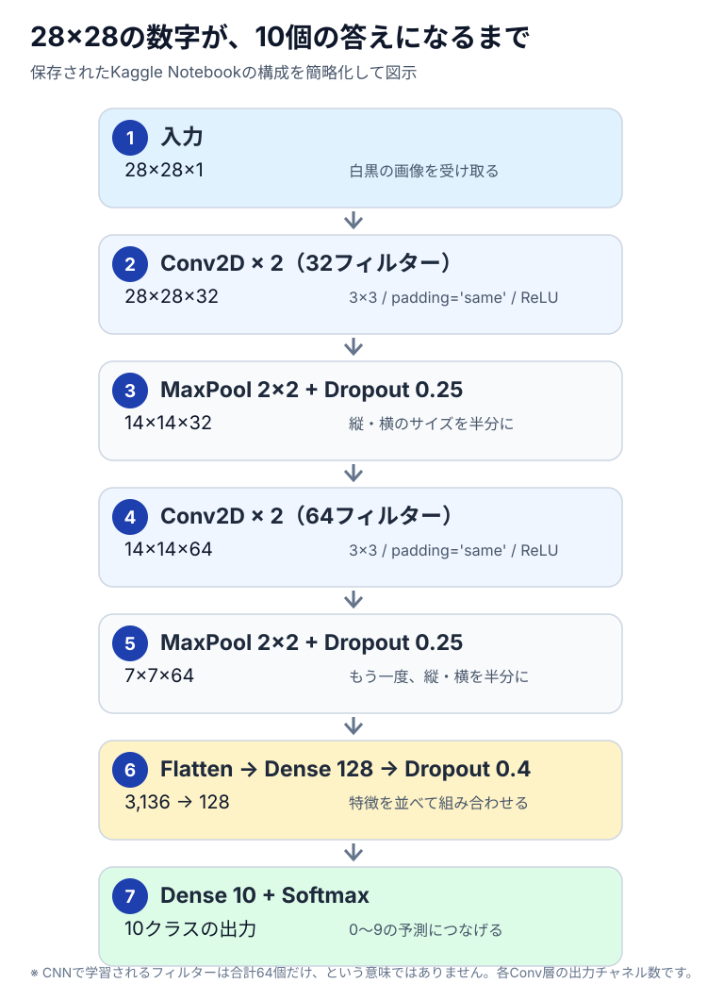
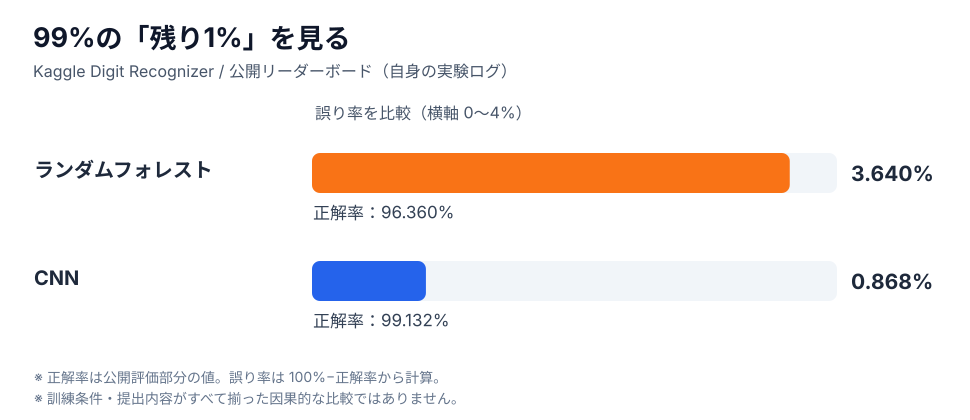

# なぜCNNは手書き数字を99%も読めるのか？ ── 「線」から「形」を見つける仕組みを図解する

**「この画像は8です」と答えるとき、AIには何が見えているのでしょう？**

人間なら、縦線や丸い輪郭を見て「8らしい」と考えられます。ところがコンピューターに渡されるのは、ただの数値の並び。Kaggleの手書き数字なら、**28×28＝784個の濃淡の値**です。

前回までの[ランダムフォレスト](random-forest-from-kaggle.md)と[多項ロジスティック回帰](multinomial-logistic-regression-from-kaggle.md)に続き、今回は**CNN（畳み込みニューラルネットワーク）**を取り上げます。数式より先に、図を見ながら「画像を小さな窓で観察する」感覚をつかみましょう。

> **今回の問い：** なぜ、画像の一部を見る小さなフィルターを重ねると、数字の認識がうまくなるのか？

!!! info "実験記録と教材図を区別します"
    Kaggle **Digit Recognizer** での **ランダムフォレスト96.360%／CNN99.132%** は、自身の[公開リーダーボードの記録](https://github.com/kumakit/kaggle/blob/main/001_digit-recognizer/learning-log.md)です。一方、記事の**5×5の画像・3×3のフィルター・プーリング行列は計算の仕組みを説明するための人工例**で、実際に学習したCNNのフィルターではありません。図の数値をKaggleの学習結果と混同しないでください。

## 1. まず、CNNの「目」を1つだけ作ってみる

最初は手書き数字全体ではなく、こんな単純な模様を考えます。0は暗い場所、1は明るい場所を表します。



左側にある **5×5の画像**に、真ん中の **3×3のフィルター**を当てています。フィルターは、いわば小さな「チェック用の型」です。

オレンジ色で囲んだ左上の3×3だけを見ると、計算は次の通り。

```text
元画像の窓       フィルター
0  0  1         -1  0  1
0  0  1         -1  0  1
0  0  1         -1  0  1

掛けて足す → (0×-1 + 0×0 + 1×1) × 3行 = 3
```

結果は **3**。次はフィルターを1マス右へ動かして、同じ計算をします。さらに右、さらに下へ……と繰り返すと、右側にある**特徴マップ（Feature Map）**ができます。

このフィルターは、**左右の濃淡が変わるところ**に反応する例です。上の図では出力の各行が **[3, 3, −3]** になります。実際のCNNでは、次のReLUという処理で負の値を0にすることがよくあります。すると各行は **[3, 3, 0]** になります。

**ポイントは、どの場所でも同じフィルターを使い回すこと**。「右上の縦線」と「左下の縦線」で、まったく別のルールを用意する必要がありません。

!!! note "数学の『畳み込み』とは少し違う？"
    実装で一般的な `Conv2D` は、厳密にはフィルターを反転させない**相互相関に相当する積和**を行います。ただし深層学習では慣習的に「畳み込み層」と呼ばれます。この図も `Conv2D` の計算に合わせています。また、この図はパディングなしで出力が3×3ですが、後述のKaggle Notebookは `padding="same"` を使い、畳み込み前後の縦横サイズを保ちます。

## 2. フィルターは「人が作る」のではなく、学習で変わる

さきほどは説明のために、左右の差を測るフィルターを**手で設定**しました。

しかし実際のCNNは、最初から「この数値なら縦線を見つけられる」と知っているわけではありません。

1. フィルターの値を仮に設定する。
2. そのフィルターで画像を処理し、数字を予測する。
3. 正解と予測のズレ（損失）を測る。
4. **誤差逆伝播**と最適化によって、フィルターやほかの重みを少しずつ修正する。

これを多数の画像で繰り返すと、学習したフィルターの一部が**線の境界や向きに反応する**ようになります。深い層では、前の層が出した特徴の組み合わせから、**角や曲がり、輪郭に関係する複雑なパターン**を扱えるようになります。

ここで大事なのは、**「CNNは最初から線の意味を理解している」わけではない**ということです。正解を当てやすくなるよう、画像の処理に使う重みがデータから調整されています。

### ロジスティック回帰と何が違う？

[第2回](multinomial-logistic-regression-from-kaggle.md)のロジスティック回帰では、元画像の位置ごとに異なる重みをつけ、各クラスのスコアを計算しました。

CNNでは、**同じ小さなフィルターを画像のさまざまな位置に適用する（重みの共有）**ことで、位置が少し変わっても似た特徴を拾えるようにします。さらに層を重ね、**近くのピクセル同士の関係**を段階的に組み合わせられます。

ただし、CNNも位置のずれに対して**完全に不変**ではありません。学習データやモデルの作り方によって強さが変わります。

## 3. 「細かく見る」の次に、あえて小さくする

CNNにはもうひとつ面白い処理があります。**MaxPooling（マックスプーリング）**です。

たとえば4×4の数値を、2×2の区画ごとにまとめてみます。



左上の4つの値は **1・3・2・1**。その中で最大の **3** だけを残します。同じことを4か所で行うと、

```text
3  5
4  6
```

という2×2の結果になります。

なぜわざわざ情報を減らすのでしょうか？

**「このあたりに線らしい特徴があった」ことを残しつつ、細かな位置の違いを気にしすぎないため**です。縦横のサイズが小さくなるので、後段の計算量も減らせます。

もちろん、位置の情報を失うデメリットもあります。どんな画像にもプーリングを入れればよいわけではありません。

## 4. 28×28の画像は、どんな順序で「数字」になる？

ここまで出てきた**畳み込み**と**プーリング**を重ねると、実際のCNNの形が見えてきます。

これは、[Kaggleで保存したCNN Notebook](https://github.com/kumakit/kaggle/blob/main/001_digit-recognizer/notebooks/03-cnn.ipynb)の**コードにある層構成**を、読みやすくまとめた図です。



ポイントを順番に見てみます。

| 段階 | 何が起きる？ |
|:---|:---|
| **入力：28×28×1** | 28×28の白黒画像。最後の1は色の情報（チャネル数）。 |
| **Conv2D（32フィルター×2層）** | 小さな3×3の窓で特徴を抽出。 `same` なので縦横28は維持。 |
| **MaxPooling** | 28×28 → **14×14** に縮小。 |
| **Conv2D（64フィルター×2層）** | 前の特徴を組み合わせ、さらに複雑なパターンを扱う。 |
| **MaxPooling** | 14×14 → **7×7** に縮小。 |
| **Flatten → Dense** | 7×7×64＝**3,136個**の値を並べ、128ユニットの層で統合。 |
| **Softmax** | 0〜9の10種類に対する予測スコアを確率形式へ変換。 |

図中の **Dropout** は、学習中に一部のユニット出力をランダムに無効化する処理です。特定の特徴に頼りすぎるのを抑える**正則化**の方法のひとつです。

そして最後の**Softmax**。これは第2回の**多項ロジスティック回帰でも使った仕組み**です。

つまりCNNは、ロジスティック回帰と完全に無関係な別世界ではありません。**画像から使いやすい特徴を学ぶ部分が大幅に増え、その先で分類する**と考えると、これまで学んだ統計とつながってきます。

!!! warning "保存Notebookと実験ログの構成は一部一致しません"
    この図は**現在リポジトリに保存されているNotebookのコード**（Dense 128、12エポック設定など）に合わせています。一方、[当時の学習ログ](https://github.com/kumakit/kaggle/blob/main/001_digit-recognizer/learning-log.md)にはDense 256・15エポックなど異なる記述があります。**公開スコア99.132%は学習ログの提出記録に基づきますが、図の構成がその提出時点の実行状態と完全に同一だったかは未確認**です。違いを隠して再現できたと主張しないようにしています。

## 5. なぜKaggleで99%を超えたのか？

実際のDigit Recognizerの[実験ログ](https://github.com/kumakit/kaggle/blob/main/001_digit-recognizer/learning-log.md)には、次の**公開リーダーボード**のスコアが残っています。



| モデル | Kaggle公開スコア | 公開スコアから計算した誤り率 |
|:---|---:|---:|
| ランダムフォレスト | 96.360% | 3.640% |
| **CNN** | **99.132%** | **0.868%** |

正解率の差は **2.772パーセントポイント**。ぱっと見ると小さく感じるかもしれませんが、誤り率を比べると**3.640% → 0.868%** と大きく変わっています。

なぜCNNが有利だったのでしょうか。考えられる理由のひとつが、**画像の空間的な構造を活かせること**です。小さな領域の特徴を繰り返し処理するCNNの構造は、手書き文字の曲がりや位置の違いを扱うのに適しています。

ただし、**この実験だけで「CNNのこの仕組みがスコア改善の原因」と断定はできません**。提出時の学習設定や検証条件が完全に統一されているとは限らず、公開スコアは評価データの公開部分についての値です。**28,000枚全部の誤答数として換算することもできません**。

実際の進歩を理解するには、異なるモデルをできるだけ同条件で比較し、[誤答分析](machine-learning-error-analysis.md)でどんな数字を間違えなくなったかを確かめるのが次の一歩です。

## 6. 自分で小さなCNNの計算を試す

「CNNを理解するために、GPUを使って何時間も学習させる必要がある？」――そんなことはありません。

今回は最初の図にある**フィルター計算とMaxPoolingだけ**を再現できる、小さなPythonスクリプトを用意しました。外部パッケージのインストールは不要です。

[計算を再現するスクリプト：cnn_filter_demo.py](https://github.com/kumakit/bearworks-docs/blob/main/scripts/cnn_filter_demo.py)

リポジトリのルートで実行します。

~~~bash
python scripts/cnn_filter_demo.py
~~~

期待される結果の一部は次の通りです。

~~~text
3×3フィルターの出力（ReLUの前）:
[3, 3, -3]
[3, 3, -3]
[3, 3, -3]

ReLUの後（負の値は0）:
[3, 3, 0]
[3, 3, 0]
[3, 3, 0]

2×2 MaxPoolingの結果:
[3, 5]
[4, 6]
~~~

ここでの値は**手で決めたフィルター**を使ったもの。学習やGPU実行はしません。**CNNモデルそのものを動かしたい場合**は、[当時のKaggle Notebook](https://github.com/kumakit/kaggle/blob/main/001_digit-recognizer/notebooks/03-cnn.ipynb)が別途ありますが、実行環境やコンペデータの利用条件、実験時点の設定を確認してください。この記事の小さなデモを実行するだけなら不要です。

## 7. 今日の持ち帰り：CNNは「形を学ぶ」仕組み

CNNを最初から複雑な数式で理解しようとすると、難しく感じるかもしれません。でも今回の図に沿えば、考え方は次のように整理できます。

- **畳み込み：** 小さなフィルターを動かし、局所的なパターンを探す。
- **学習：** フィルターなどの値を、正解を当てやすい方向へ調整する。
- **プーリング：** 強い反応を残し、位置の細かな違いをある程度まとめる。
- **分類：** 積み上げた特徴を組み合わせ、最後は10種類の数字を予測する。

統計の勉強で学んできた**予測・検証・過学習・正則化**の考え方は、CNNにも共通しています。違うのは、**画像のどんな特徴が役立つかを、モデル自身が段階的に学ぶ**ところです。

では最後に、少し意地悪な問いを。

**「CNNが『線』を見つけると言うけれど、本当に学習後のフィルターは線に反応しているのか？」**

次は**学習済みCNNのフィルターや特徴マップを実際に可視化する実験**をすると、今日の図が単なるイメージで終わらず、もっと面白くなりそうです。

---

## 出典・関連記事

- [KaggleのCNN Notebook（保存された実装）](https://github.com/kumakit/kaggle/blob/main/001_digit-recognizer/notebooks/03-cnn.ipynb)
- [Kaggle Digit Recognizerの実験ログ（公開スコア）](https://github.com/kumakit/kaggle/blob/main/001_digit-recognizer/learning-log.md)
- [TensorFlow：畳み込みニューラルネットワーク入門（日本語）](https://www.tensorflow.org/tutorials/images/intro_to_cnns?hl=ja)
- [Keras：Conv2D](https://keras.io/api/layers/convolution_layers/convolution2d/)
- [Keras：MaxPooling2D](https://keras.io/api/layers/pooling_layers/max_pooling2d/)
- [第1回：ランダムフォレスト](random-forest-from-kaggle.md)
- [第2回：多項ロジスティック回帰](multinomial-logistic-regression-from-kaggle.md)
- [第3回：機械学習はどこで間違える？](machine-learning-error-analysis.md)
- [第4回：AIの予測を人が確認する（Draft PR #6）](https://github.com/kumakit/bearworks-docs/pull/6)

*作成：2026-11-22／関連Issue：[記事化 #439](https://github.com/kumakit/mission-control/issues/439)・[Kaggle学習 #402](https://github.com/kumakit/mission-control/issues/402)*
