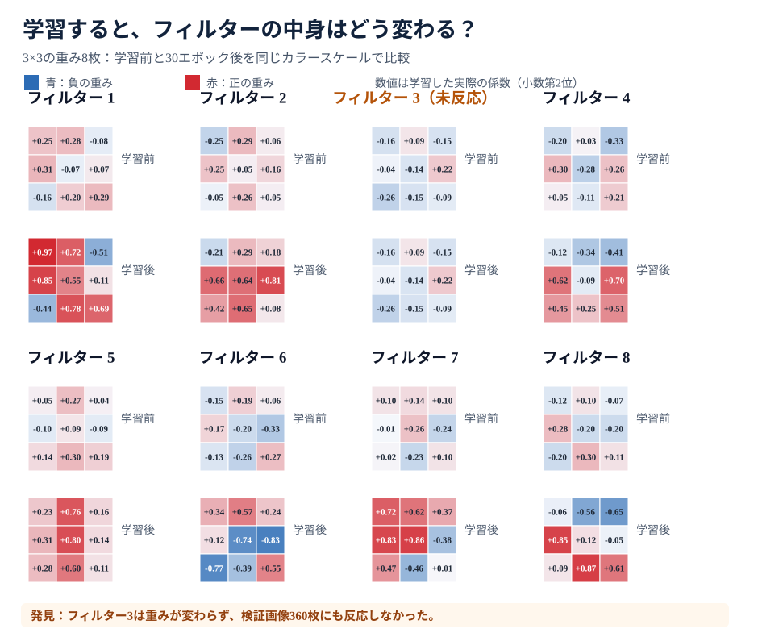
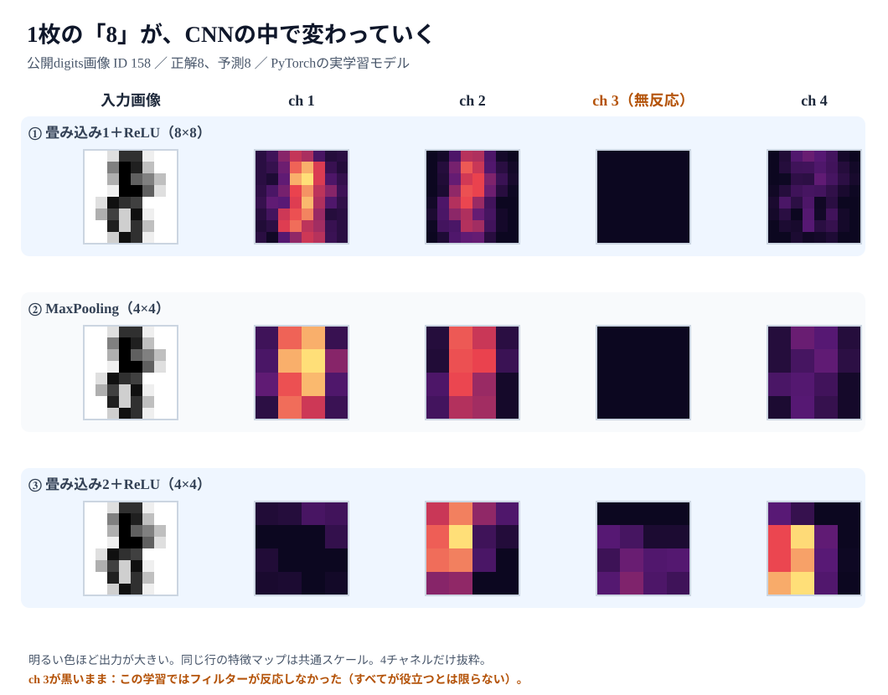
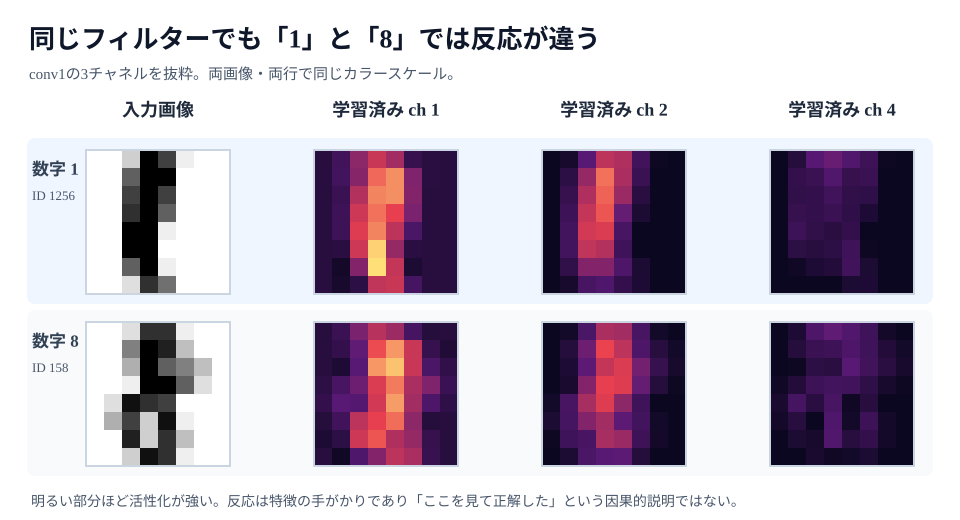

# CNNは本当に「線」や「形」を見ている？ ── 学習したフィルターを開いてみた

**「CNNは画像から線や形の特徴を学ぶ」**。前回の図解では、そう説明しました。

でも、そこで気になりませんか？

**「それは仕組みの説明なのか。それとも、実際に学習したAIの中を見た結果なのか？」**

今回は、説明用のフィルターを手描きするのではなく、**CNNを実際に学習させ、その内部の重みと特徴マップを取り出して確かめてみます**。

すると、期待どおりの発見だけでなく、意外な事実も見つかりました。**学習後も重みがまったく動かず、入力画像に反応しなかったフィルター**があったのです。

> **この記事で確かめること**：CNNのフィルターは学習前後でどう変わる？ 同じ画像が層を通るとどうなる？ 「1」と「8」では反応がどう違う？

!!! info "重要：これはKaggle提出済みCNNの内部ではありません"
    [第5回「なぜCNNは手書き数字を99%も読めるのか？」](cnn-digit-visual-guide.md)は、Kaggle **Digit Recognizer**（28×28画像）の経験をもとにした仕組みの図解でした。今回の実験では、その**提出時の学習済み重みは取り出していません**。

    代わりに、誰でも手元で再現できるよう[scikit-learn付属のdigits](https://scikit-learn.org/stable/modules/generated/sklearn.datasets.load_digits.html)（8×8画像）で**小型CNNを新しく訓練**しました。記事の図はその学習済みモデルから実際に計算した数値に基づいています。**Kaggleでの99.132%という公開スコアとは別の実験**です。

## 1. まず、本当にCNNを学習させた

今回使ったのは、**PyTorchで組んだ小さなCNN**です。GPUを使わずにCPUだけで学習できる構成にしました。

公開digitsデータは全部で**1,797枚**あります。そのうち1,437枚で学習し、残りの360枚を検証用として取り分けました。

| 項目 | 今回の条件 |
|:---|:---|
| データ | scikit-learn digits（8×8、グレースケール） |
| 分割 | 学習1,437枚／検証360枚、層化抽出 |
| モデル | Conv2D（8チャネル）→ ReLU → MaxPool → Conv2D（16チャネル）→ ReLU → MaxPool → 全結合 |
| 学習 | Adam、30エポック、乱数シード42、CPU |
| **検証結果** | **348 / 360枚正解（96.67%）** |

ここでは**最高スコアを狙っていません**。あえて小さなモデルを使うことで、「何が学習され、どこでどんな反応が出るのか」を見やすくしています。数値はPyTorch 2.10.0+cpu／scikit-learn 1.8.0で実行した結果です。

## 2. フィルターを「学習前」と「学習後」で並べてみる

[第5回の説明用フィルター](cnn-digit-visual-guide.md)では、最初から左右の濃淡を拾えるように数値を決めていました。

しかし実際のCNNは、最初からそんな便利なフィルターを持っているわけではありません。重みは初期値からスタートし、学習を通じて修正されます。

では、最初の畳み込み層（Conv1）にある**8枚の3×3フィルター**を見比べてみましょう。

赤は**正の重み**、青は**負の重み**を表し、どのフィルターも同じカラースケールで揃えています。各マスの数字は、実際に得られた重みの値を小数第2位に丸めたものです。

たとえば**フィルター1**を見ると、学習前はおおむね−0.16〜0.31程度だった値が、学習後には−0.51〜0.97へ変化しました。単純な左右差だけとは言えませんが、隣り合うピクセルの違いに反応できるよう、**3×3の重みの組み合わせが変わった**ことが読み取れます。

!!! tip "ここで見えているものは「重要ピクセルランキング」ではない"
    フィルターの重みが大きいからといって、その場所が「正解の決め手」になるとは限りません。出力は**入力画像との掛け算と足し算**で決まり、その先にも多数の層が続きます。また今回の3×3フィルターは、画像の決まった位置専用ではなく**画像中のさまざまな場所で共有**されます。

### 意外な発見：フィルター3が変わっていない

図を見比べると、**フィルター3だけ学習前後でまったく同じ**なのが分かります。

これは図の描き間違いではありません。実際に計算してみたところ、最初の8チャネルのうち**3番の重みの平均絶対変化は0**でした。さらに、**検証用360枚すべてで、3番のチャネルのReLU後の出力が0**になっていました。

今回の学習では、このチャネルが実質的に働いていなかったのです。

CNNであっても、**用意したフィルターがすべて有効に使われるとは限らない**。これは、実際の重みを覗いてみたからこそ分かった発見でした。

## 3. 「8」を1枚入力すると、内部はどうなる？

重みの次は、**実際の画像を入力したときの途中の出力**を見てみます。

ここで使うのは、公開digitsの**画像ID 158**です。正解は「8」で、今回のCNNも正しく「8」と予測した画像になります。

まず左端の**元画像**が入力されます。続く各列が**特徴マップ（Feature Map）**です。

- **① 畳み込み1 ＋ ReLU**：8×8の位置ごとに、各フィルターの反応が出ます。
- **② MaxPooling**：2×2ごとに大きい値を残し、4×4に縮小します。
- **③ 畳み込み2 ＋ ReLU**：前の層の**複数チャネルを組み合わせて**、新しい特徴マップを作ります。

明るい部分ほど、そのチャネルの出力が大きい場所です。**同じ段の特徴マップは共通の色の目盛り**で描いています。ただし、段をまたいだ明るさを同じ絶対値として比べることはできません。

右側にある**ch 3**に注目すると、①と②が**真っ黒**です。先ほどの「学習後も変わらなかったフィルター3」が、実際の画像に対しても反応していません。

一方で、③のch 3は黒一色にはなっていません。**畳み込み2のch 3は、畳み込み1のch 3とは別のフィルター**であり、前段の複数チャネルを材料にしているためです。

「同じ列番号なら同じものを見ている」と考えないことも大切です。

## 4. 同じフィルターを「1」と「8」に使うと？

**同じフィルターを画像のあちこちに使い回す**のがCNNの特徴です。

それなら、入力される数字が変わったときも、そのフィルターは同じように反応するのでしょうか？

公開digitsから、正しく予測できた**「1」（ID 1256）**と**「8」（ID 158）**を取り出し、**まったく同じ学習済みフィルター**に通してみました。

どちらも中央付近の線に強く反応しているチャネルがあります。ただ、**明るい場所の位置や広がり方は異なっています**。

ここがCNNの面白いところです。

「これは1専用のフィルター」「これは8専用のフィルター」と1対1で割り当てているわけではありません。複数のフィルターの反応を、後ろの層が組み合わせながら分類へつなげています。

同じフィルターでも、入力画像が変われば**特徴マップの形が変わる**。その途中経過を、こうして実物として確かめることができます。

## 5. 特徴マップは「AIの目線」そのものなのか？

ここで、ひとつ気をつけたい点があります。

**この特徴マップだけを見て、「AIがここを見たから正解した」と断定することはできません。**

特徴マップは、あくまで**特定の層が出した途中の数値**にすぎません。強く反応した場所が、そのまま最終予測の決定的な証拠になるとは限らないのです。

さらに、フィルターがどんな模様に反応しているかを判断するには、**多くの画像を比較したり、入力の一部を変えて出力への影響を確かめたり**する必要があります。今回は「線や形を学ぶ仕組みの内部を観察した」という段階にとどまります。

なお、3番のチャネルが働かなかった原因についても、**今回は現象を確認しただけ**です。ReLUで出力が0になると、そのチャネルに勾配が流れにくくなることがありますが、1回の実験だけで一般化はできません。

### 統計の学習とつながる部分

ここまで見てくると、CNNは特殊なブラックボックスというより、**途中の値を調べられる推定モデル**に思えてきませんか？

ただし、「内部の重みが変わった」という**観察**と、「その変化が予測精度の改善を引き起こした」という**因果的な説明**は別物です。この区別は、統計学でも大切な考え方になります。

## 6. 自分のPCでも再現できる

今回の実験は、**学習から可視化までPythonスクリプト1本**で完結します。KaggleのCSVもGPUも使いません。

[再現用スクリプト：visualize_learned_cnn.py](https://github.com/kumakit/bearworks-docs/blob/main/scripts/visualize_learned_cnn.py)

PyTorch・scikit-learn・Matplotlibを使用します。これらが使えるPython環境がすでにあれば、リポジトリのルートから次のように実行できます。

~~~bash
python scripts/visualize_learned_cnn.py
~~~

[uv](https://docs.astral.sh/uv/)を使う場合は、次のコマンドでも実行できます。ただしPyTorchはパッケージサイズが大きいため、初回の環境準備ではダウンロードが発生します。

~~~bash
uv run --no-project --with torch==2.10.0 --with scikit-learn==1.8.0 --with matplotlib==3.10.8 python scripts/visualize_learned_cnn.py
~~~

実行すると、**フィルターの学習前後・特徴マップ・「1」と「8」の比較**の3枚のSVGが `docs/images/` に出力されます。記事に掲載した画像は同じ実験結果を**記事向けにレイアウト調整**したもので、スクリプトのMatplotlib版とは装飾が異なります。

なお、乱数シードを固定していても、PyTorchの実行環境やバージョンによって数値が多少変わることがあります。**同一条件での再現**と、**別環境でも完全に同じ小数になること**は切り分けて考えてください。

!!! warning "目的はKaggleの99.132%の再現ではありません"
    今回は**8×8の公開データ・別の小型CNN・CPU**を使いました。Kaggleの28×28画像で公開スコア99.132%を出したモデルとは、**データ・構造・学習設定が異なります**。今回の96.67%とKaggleの99.132%を直接比べて、優劣を判断しないでください。

## 7. CNNを「図解」から「実物」に進めてみて

今回の発見を3つに整理します。

1. **フィルターの数値は、本当に学習で変わった。** 人が決めた固定ルールではなく、データに合わせて修正されている。
2. **同じ画像が層を進むと、別の特徴マップになる。** 画像の場所ごとの反応を、さらに後ろの層が組み合わせている。
3. **すべてのフィルターが働くわけではなかった。** 学習後、検証用360枚すべてでReLU後の出力が0だったチャネルまで、可視化によって見つかった。

CNNを理解するうえで、「すべてのフィルターがきれいなエッジ検出器になるはず」と思い込まないことも大切だと分かりました。

では、もし**特定のピクセルを消したり、数字の位置を少し動かしたり**したら、CNNの反応と予測はどう変わるのでしょうか？

次に実験するなら、**入力を意図的に変えて、モデルの弱点を探る**のも面白そうです。

---

## 出典・関連記事

- [第5回：CNNの畳み込みとプーリングを図解](cnn-digit-visual-guide.md)
- [第3回：機械学習はどこで間違えるのか？](machine-learning-error-analysis.md)
- [第4回：AIが自信のない予測だけ人に確認してもらう](uncertain-predictions-human-review.md)
- [Kaggle Digit Recognizer 実験ログ](https://github.com/kumakit/kaggle/blob/main/001_digit-recognizer/learning-log.md)
- [scikit-learn：load_digits](https://scikit-learn.org/stable/modules/generated/sklearn.datasets.load_digits.html)
- [PyTorch：Conv2d](https://docs.pytorch.org/docs/stable/generated/torch.nn.Conv2d.html)
- [PyTorch：ReLU](https://docs.pytorch.org/docs/stable/generated/torch.nn.ReLU.html)
- [PyTorch：MaxPool2d](https://docs.pytorch.org/docs/stable/generated/torch.nn.MaxPool2d.html)

*作成：2026-11-23／関連Issue：[記事化 #439](https://github.com/kumakit/mission-control/issues/439)・[Kaggle学習 #402](https://github.com/kumakit/mission-control/issues/402)*
