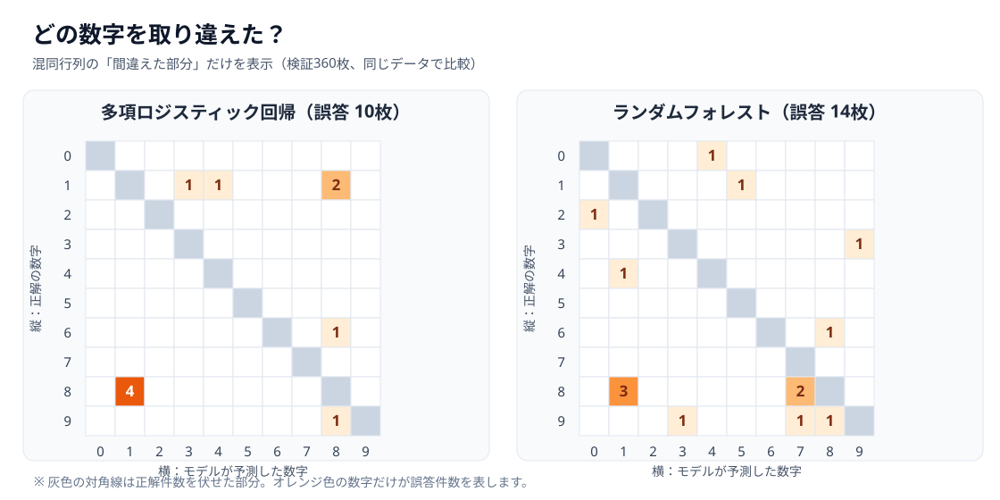
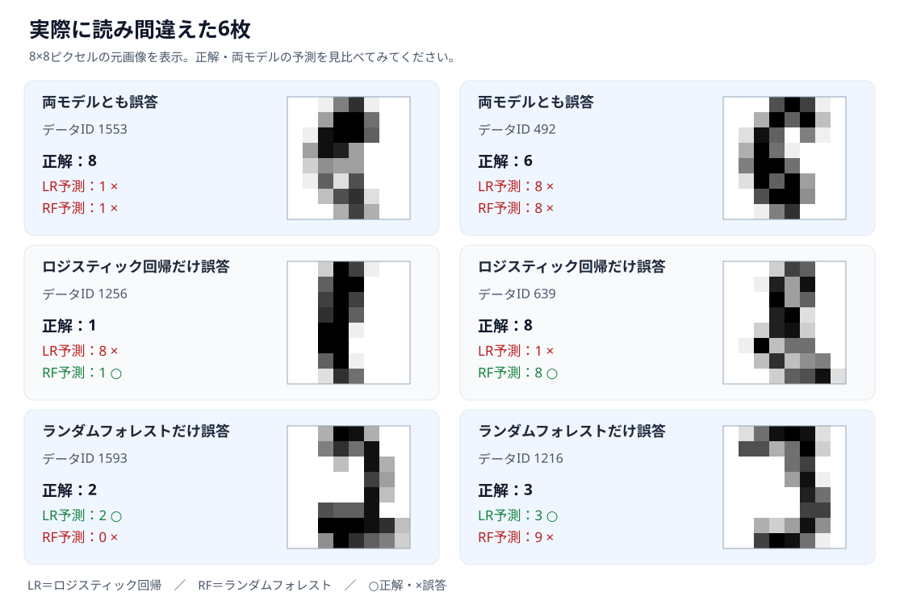

# 正解率97%の裏で、AIは何を間違えている？ ── 手書き数字と混同行列で学ぶ「誤答分析」

**「97%正解しました」と聞いたら、どんな印象を持つでしょうか。**

なかなか優秀で、もう実用できそう。そんなふうに思えますよね。ところが、実際に**間違えた10枚**を並べてみると、少し違った景色が見えてきました。

- 「8」を「1」と読み間違える例が何度も出てくる。
- 同じ画像なのに、**2つのモデルで答えが分かれる**。
- 片方のモデルでは正解だった画像を、もう片方は間違えている。

今回は、モデルをもう1つ増やすのではなく、**「当たった数」から「間違え方」へ視点を移す**実験です。前回までの[ランダムフォレスト](random-forest-from-kaggle.md)と[多項ロジスティック回帰](multinomial-logistic-regression-from-kaggle.md)を使い、間違えた画像そのものを覗いてみます。

> **この記事で分かること：** 正解率だけでは見えないこと／混同行列の読み方／モデルごとの誤答の違い／業務における「見逃し」と「誤検知」の考え方。

!!! info "データについて：Kaggleの実験と今回の再現実験は別物です"
    Kaggle **Digit Recognizer**（28×28ピクセル）の実験記録では、同じ8,400枚の検証画像に対して**ロジスティック回帰91.74%（誤答694枚）／ランダムフォレスト96.43%（誤答300枚）**という結果でした（[実験ログ](https://github.com/kumakit/kaggle/blob/main/001_digit-recognizer/learning-log.md)）。

    **ここから先の図・画像・具体的な誤答件数は、別データ**であるscikit-learn付属の**digits**（8×8ピクセル）を使って新たに再現したものです。Kaggleの誤答画像を転載したものではなく、両データセットの精度を直接比べることもできません。

## 1. 97%正解。それでも、間違える数字には偏りがあった

まずは[前回の記事](multinomial-logistic-regression-from-kaggle.md)と同じ公開データ・同じ分割条件で比べてみます。

scikit-learnの手書き数字データ **1,797枚**を学習用80%・検証用20%に分け、検証用の**360枚**で結果を確認しました。

| モデル | 正解 | 誤答 | 正解率 |
|:---|---:|---:|---:|
| 多項ロジスティック回帰 | **350枚** | **10枚** | **97.22%** |
| ランダムフォレスト（100本） | 346枚 | 14枚 | 96.11% |

この表だけを見ると、ロジスティック回帰がわずかに優勢です。ただし、差は**360枚中の4枚**にすぎません。これだけで一般的な優劣を判断することはできません。

面白いのは、**間違えた10枚と14枚の中身**です。誤答した組み合わせだけを集計してみました。

左がロジスティック回帰、右がランダムフォレストです。**縦が本当の数字、横がモデルの予測**を表しています。色が濃いマスほど取り違えが多く、マスの中の数字が件数です。正しく当てた対角線のマスは、間違いを見やすくするため灰色にして隠しました。

ここで目を引くのが、**本当は「8」なのに「1」と予測した件数**です。

- ロジスティック回帰：**4枚**
- ランダムフォレスト：**3枚**

ロジスティック回帰の誤答10件のうち、4件が同じパターンの間違いでした。逆向きの「1」を「8」と読む誤りも2件あります。

**全体の正解率を1つ眺めているだけでは、こうした偏りには気づけません。**

## 2. どんな画像を間違えた？ 実物を見てみる

では、検証データのうち実際にモデルが間違えた**6枚**を見てみましょう。これらは説明用に作った架空の文字ではなく、[scikit-learnのdigitsデータ](https://scikit-learn.org/stable/modules/generated/sklearn.datasets.load_digits.html)に含まれている実際の8×8画像です。

*LR＝ロジスティック回帰、RF＝ランダムフォレスト。画像の「ID」は公開digitsデータにおける行番号です。*

**上段：両方が間違えた画像。** たとえばID 1553は正解が「8」ですが、両モデルとも「1」と予測しました。8×8ピクセルという限られた情報では、モデルにとって区別しにくい形もあるようです。もっとも、人間にとっても読み分けが難しい画像かどうかは、別途人の判定を調べなければ断言できません。

**中段：ロジスティック回帰だけが間違えた画像。** ID 1256は正解が「1」です。ロジスティック回帰は「8」と判定した一方、ランダムフォレストは正しく「1」と当てました。

**下段：ランダムフォレストだけが間違えた画像。** ID 1593は正解が「2」です。こちらはロジスティック回帰が正解したのに対し、ランダムフォレストは「0」と答えています。

「複雑なモデルなら必ず当たる」「シンプルなモデルなら必ず外れる」わけではありません。**モデルによって、苦手な例が違う**のです。

## 3. 2つのモデルは、同じ画像を間違えるのか？

検証用の360枚を**どちらのモデルが正解したか**で整理すると、次のようになりました。

| 組み合わせ | 枚数 |
|:---|---:|
| 両方とも正解 | 342枚 |
| 両方とも誤答 | **6枚** |
| ロジスティック回帰だけ誤答 | 4枚 |
| ランダムフォレストだけ誤答 | 8枚 |
| **合計** | **360枚** |

つまり、ランダムフォレストが間違えた14枚のうち、**8枚はロジスティック回帰なら正解していた**ことになります。逆に、ロジスティック回帰が間違えた10枚のうち、**4枚はランダムフォレストなら正解していました**。

ここから見えてくるのは、単に「モデルを組み合わせれば精度が上がる」という話ではありません。**予測が割れた画像を拾い上げると、追加で確認すべき候補を見つけられる**ということです。

!!! warning "2つのモデルの意見が一致すれば、正解？"
    **いいえ。** 6枚は両方とも間違えました。意見の食い違いは確認すべき候補の目印になりますが、意見が一致したからといって正しさは保証されません。また、ここでの件数は**1つの検証用分割に対する結果**であり、将来のデータでも同じ割合になるとは限りません。

## 4. 誤答分析は、混同行列から始める

今回使った図は、**混同行列（Confusion Matrix）**の「正解した部分」を隠したものです。混同行列は、正解ラベルと予測ラベルを突き合わせて、**どの種類の取り違えが何件起きているか**を一覧にする表です。

読み方はシンプルです。

- **縦の数字**：「本当は何だったか」
- **横の数字**：「モデルは何だと答えたか」
- **対角線**：正解した件数（今回の図では隠している）
- **対角線以外**：別のクラスと取り違えた件数

正解率の高さだけでなく、**どのクラスで、どちらの方向に間違えているか**を見るのがポイントです。同じ「8と1の取り違え」でも、**8を1と予測する**場合と**1を8と予測する**場合では、表の行と列が逆になります。

## 5. 仕事では「何件間違えたか」より「何を見逃したか」

これを社内SEの業務に置き換えて考えてみます。たとえば、問い合わせを「緊急対応」と「通常対応」に自動分類する仕組みを想定しましょう。

問い合わせが1,000件あり、そのうち緊急案件が10件（1%）だったとします。**すべて「通常対応」と予測するだけでも、正解率は99%**に達します。それでも、緊急の10件をすべて見逃してしまうなら、役に立つとは言えません。こうした場面では、**2種類の間違い**を分けて考える必要があります。

| 間違いの種類 | 問い合わせ分類の例 | 起こりうる影響 |
|:---|:---|:---|
| **見逃し（偽陰性）** | 本当は緊急なのに「通常」と判定 | 対応の遅れや障害影響の拡大 |
| **誤検知（偽陽性）** | 本当は通常なのに「緊急」と判定 | 不必要なエスカレーションや担当者の負担 |

そこで、緊急案件をどれだけ拾えたかを見る**再現率（Recall）**と、「緊急」と判定した中で本物がどれだけあったかを見る**適合率（Precision）**を確認します。

どちらを重視すべきかは業務の性質によります。障害の初動対応なら、見逃しを減らしたいかもしれません。一方で、誤検知が多すぎると担当者が通知に疲れてしまいます。**良いモデルの基準は、正解率の数字だけでは決められません。**

!!! note "予測と施策効果は別の問い"
    「緊急問い合わせを予測できるか」と「分類機能を導入した結果、対応時間が短くなったか」は別の問題です。後者を確かめるには、導入前後の条件や比較方法も含めた検証設計が必要になります。

## 6. 自分でも再現する：実行は1コマンド

今回の図2枚は、公開データとPythonだけで手元で生成できます。**社内データもKaggleのCSVも不要**です。

[再現用スクリプト：analyze_digit_errors.py](https://github.com/kumakit/bearworks-docs/blob/main/scripts/analyze_digit_errors.py) をリポジトリのルートから実行します。[uv](https://docs.astral.sh/uv/) が入っていれば、次の1コマンドで必要なパッケージを一時的に用意して動かせます。

~~~bash
uv run --no-project --with scikit-learn==1.8.0 --with matplotlib==3.10.8 python scripts/analyze_digit_errors.py
~~~

この実験でそろえた条件は、**同じ360枚を検証すること／乱数シードを42に固定すること／ロジスティック回帰は訓練データだけで標準化すること**の3点です。実行すると誤答の内訳が表示され、次の2つの図が出力されます。

- `docs/images/digit-errors-confusion.svg`：誤答部分だけの混同行列
- `docs/images/digit-errors-examples.svg`：本当に間違えた画像6枚

使用データはscikit-learn付属のdigits（1,797件）で、Python 3.13.5／scikit-learn 1.8.0で数値を確認しました。別のバージョンや条件では結果が変わる可能性があります。

## 7. 次の分析で試したい「3つの問い」

今回は、正解率だけを見ていたときには見えなかった傾向が、誤答を並べることで浮かび上がりました。

- **どの種類の間違いが多い？** → 混同行列で誤りの方向を確認する。
- **どんな入力で間違える？** → 実際の誤答画像や業務レコードを調べる。
- **その間違いは、仕事でどれくらい困る？** → 見逃し・誤検知のコストを考える。

ここで、もう1つ気になる点が出てきます。**「この予測は自信がない」と、モデル自身に教えてもらうことはできるのでしょうか？**

次は予測確率や判定のしきい値に目を向けると、「すべてを自動判定せず、迷うものだけ人間に回す」という実務的な設計につながりそうです。

---

## 出典・関連記事

- [前編①：Kaggleから学ぶランダムフォレスト](random-forest-from-kaggle.md)
- [前編②：多項ロジスティック回帰の判断を覗く](multinomial-logistic-regression-from-kaggle.md)
- [Kaggle Digit Recognizer の学習・実験ログ](https://github.com/kumakit/kaggle/blob/main/001_digit-recognizer/learning-log.md)
- [scikit-learn：load_digits（データの出典）](https://scikit-learn.org/stable/modules/generated/sklearn.datasets.load_digits.html)
- [scikit-learn：confusion_matrix](https://scikit-learn.org/stable/modules/generated/sklearn.metrics.confusion_matrix.html)
- [scikit-learn：分類モデルの適合率・再現率](https://scikit-learn.org/stable/modules/model_evaluation.html#precision-recall-f-measure-metrics)
- [scikit-learn：よくある落とし穴（データリーク）](https://scikit-learn.org/stable/common_pitfalls.html)

*作成：2026-11-22／関連Issue：[記事化 #439](https://github.com/kumakit/mission-control/issues/439)・[Kaggle #402](https://github.com/kumakit/mission-control/issues/402)*
