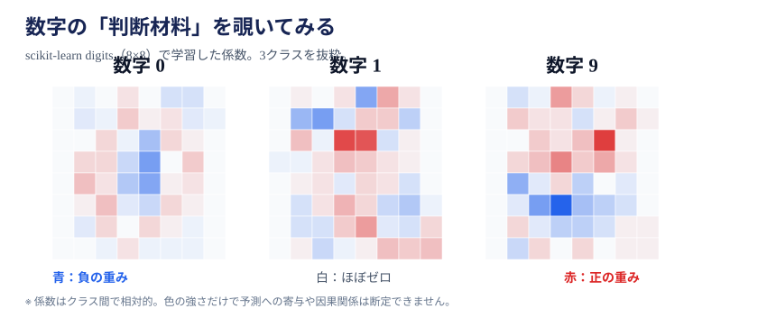

# AIは「1」と「9」をどう見分ける？ ── 多項ロジスティック回帰の判断を覗いてみた

AIが「これは9です」と答えたとき、**画像のどこを見て9だと判断したのか**気になったことはありませんか？

前回の[「木を100本集めたら、手書き数字が読めた」](random-forest-from-kaggle.md)では、Kaggleの手書き数字認識でランダムフォレストが好成績を収めました。今回はその比較相手だった**多項ロジスティック回帰（線形モデル）**を取り上げます。一見すると地味なモデルですが、中身を覗いて「何を根拠に判断しているか」を確かめやすいのが面白いところです。

> **今回の問い**：「AIが文字のどの部分を手がかりにしているのか、重み（係数）から読み解けるのか？」

!!! info "データと数値について"
    冒頭で紹介する数値は、[Kaggle Digit Recognizer の実験記録](https://github.com/kumakit/kaggle/blob/main/001_digit-recognizer/learning-log.md)からの引用です。一方、係数の可視化と再現コードには、別の**公開データ**であるscikit-learn付属の手書き数字（8×8画像）を使います。Kaggleの28×28画像とは異なるデータセットのため、**両者の正解率を直接比べることはできません**。

## 1. 「負けたモデル」から始める理由

2026年10月に挑戦したKaggleのDigit Recognizerでは、同じ8,400件の検証用画像に対して次のような結果が出ました。

| 分類モデル | 検証正解率 | 誤答 |
|:---|---:|---:|
| **多項ロジスティック回帰** | 91.74% | 694件 |
| ランダムフォレスト（100本） | **96.43%** | 300件 |

検証正解率の数字だけを見ればランダムフォレストの勝ちです。それでも、**どうやって予測を組み立てているかが見えやすい**モデルには、また違った価値があります。

ロジスティック回帰は、「どの特徴量が各分類のスコアをどれだけ押し上げたり押し下げたりするか」を係数として持っています。手書き数字のような画像データで、その係数を実際に並べて確かめてみましょう。

## 2. 「回帰」なのに、やっていることは「分類」

ロジスティック回帰という名前がついていますが、ここで予測するのは売上のような連続値ではなく、画像を **0〜9の10クラスに分類する**ことです。

- **2値ロジスティック回帰**：通常／緊急のように、2つの選択肢のどちらかに分ける。
- **多項ロジスティック回帰**：0、1、2、…、9のように、3種類以上の選択肢から分ける。

今回の多項ロジスティック回帰では、まず各数字に対して**スコア**を計算します。

$$
z_k = b_k + \sum_{j=1}^{64} w_{kj}x_j
$$

$x_j$ は64個あるピクセルの値、$w_{kj}$ は数字 $k$ に対応する各ピクセルの重み、$b_k$ は基準となる切片（バイアス）です。最初に各ピクセルを標準化してから入力するため、ここでの $x_j$ は元の濃淡そのものではなく**標準化後の値**になります。

続いて、10種類のスコアを**合計が1になる確率**へ変換します。この変換が *softmax（ソフトマックス）* です。

$$
P(Y=k\mid x)=\frac{\exp(z_k)}{\sum_{\ell=0}^{9}\exp(z_\ell)}
$$

最後に、最も確率が高い数字を予測結果として選びます。押さえておきたいのは、**各数字のスコアがピクセルの重み付き足し算で作られている**という点です。入力からスコアへの関係が線形であるため「線形モデル」と呼ばれます。ソフトマックスを通した後の予測確率そのものが線形という意味ではありません。

## 3. モデルの頭の中をヒートマップで覗く

次の図は、scikit-learnの8×8画像データを使って多項ロジスティック回帰を学習させ、得られた係数を並べたものです。10個の数字から**0・1・9**の3つを抜粋しました。

**赤い部分はその数字のスコアを引き上げる方向、青い部分は引き下げる方向**に働きます。たとえば「1」を見ると、画像の中央付近を通る縦線に対応する領域に、正の重みが見られます。見慣れた「1」の形を思い浮かべると、少し納得できるかもしれません。

ただし、この図は**1枚の画像を見たときにAIが注目した場所**ではありません。全訓練データから学習した**クラスごとの係数**です。標準化した特徴量同士には相関がありますし、同じピクセルの重みが他のクラスでどうなっているかによっても確率は変わります。「赤いからその数字になる確率が必ず上がる」「係数が大きいから原因だ」とは言えません。

ここで読み取れるのは、あくまで「モデルが大まかにどのあたりの位置情報を使って見分けているか」という**手がかり**です。

## 4. 最小限のコードで試してみる

Kaggleのコンペデータは必要ありません。[scikit-learn付属のdigitsデータ](https://scikit-learn.org/stable/modules/generated/sklearn.datasets.load_digits.html)（8×8、1,797枚）を使います。

[再現スクリプト（GitHub）](https://github.com/kumakit/bearworks-docs/blob/main/scripts/explain_multinomial_logistic.py) を動かすと、データ分割・標準化・モデル学習・検証・ヒートマップのSVG出力までを一気に実行できます。

リポジトリのルートから次のコマンドを実行してください。

~~~bash
uv run --no-project --with scikit-learn==1.8.0 python scripts/explain_multinomial_logistic.py
~~~

スクリプトでは、データを訓練用80%・検証用20%に分割し、訓練データだけを使って標準化の基準を計算します。**検証データの情報を学習側に漏らさない**のは、データリークを防ぐためです。実験の再現用に乱数シードも42で固定しています。

Python 3.13.5 / scikit-learn 1.8.0で実行した結果は次の通りでした。

| 指標 | 結果 |
|:---|---:|
| 全データ | 1,797件 |
| 検証用データ | 360件 |
| 正解 | **350件** |
| 誤答 | 10件 |
| **検証正解率** | **97.22%** |

実行が終わると、ヒートマップが `docs/images/logistic-regression-pixel-weights.svg` に保存されます。

前回の記事で同じ公開データにランダムフォレストを使ったときは**96.11%**でしたので、ここでは多項ロジスティック回帰がわずかに上回っています。ただし、Kaggleとは画像解像度も前処理も異なりますし、今回は1回の分割で試しただけです。**この結果だけで、どちらが一般に優れているかは判断できません。**

!!! tip "実務で比較するとき"
    まずは同じデータ分割・同じ評価指標で、シンプルなモデルどうしを比べてみましょう。結果が数件しか違わないときは、分割によるばらつきや業務上の見逃しコストまで踏まえて検討するのが大切です。スコアの数字だけでモデルを決める必要はありません。

## 5. なぜランダムフォレストに負けることがある？

多項ロジスティック回帰では、各数字のスコアが**切片とピクセル値の重み付き和**で決まります。仕組みが明快な一方で、複数のピクセルが組み合わさって特定の形を作っているような**複雑なパターン**を、そのまま捉えるのは苦手です。

対して、決定木を集めるランダムフォレストは「ここが暗く、かつあそこも暗いなら」といった**条件の組み合わせ**を表現できます。画像の位置ずれや曲がり方が多様なKaggleのデータでは、その柔軟さが有利に働いた可能性があります。

もちろん、線形モデルでも十分に分けられるデータであれば、シンプルなロジスティック回帰が良い性能を出すこともあります。**「単純なモデルだから劣る」とは限らない**のです。

なお、画像特有の平行移動や周辺ピクセルの形状に強く対応したい場面では、CNNなどの選択肢もあります。今回の比較だけでCNNの優劣まで判断する必要はありません。

## 6. 仕事で使うなら？

たとえば社内の問い合わせを、**アカウント・請求・データ連携**の3カテゴリに振り分けたいとします。問い合わせ文を数値の特徴量に変換できれば、多項ロジスティック回帰は比較の土台にしやすい初期モデルになります。

- **向いている場合**：まずシンプルな基準モデルを作りたい／処理を速くしたい／どの特徴量が分類に関連しているか確かめたい。
- **向かない場合**：複雑な非線形関係が大きい／分類の根拠を係数だけでは説明しきれない／そもそも単純な業務ルールで十分間に合う。
- **注意が必要な場合**：特定カテゴリが極端に少ない／正解ラベルが曖昧／予測する時点ではまだ分からない情報が特徴量に混ざっている。

**係数はあくまで説明の手がかりであり、因果効果の証明ではありません。** 問い合わせ本文を扱う場合は、個人情報や機密情報を匿名化・適切に管理し、公開データと混ぜないようにします。

また、カテゴリを予測できることと、「ある施策を打てば問い合わせが減る」と言えることは別問題です。改善施策の効果を確かめるには、それに合わせた別の検証設計が必要になります。

## 7. 次に試すなら「間違えた10枚」を見る

今回の実験では、360枚のうち**10枚を間違えました**。

まさにその10枚に、「モデルがどんな文字を取り違えやすいのか」という次の問いが隠れています。全体の平均正解率だけを眺めるより、間違えた画像や混同行列を実際に見てみる方が、改善のヒントが見つかることがあります。

記事を読み終えたら、次の3点を振り返ってみてください。

- [ ] **分類したい種類**が2つなのか、3つ以上なのか説明できるか。
- [ ] ヒートマップの赤・青が**正解の理由そのものではなく係数**だと区別できるか。
- [ ] 仕事のデータで**正解率だけでは見逃す失敗**がないか考えられるか。

前回は「木を100本集めるとどうなるか」、今回は「線形モデルが何を根拠に数字を分けるのか」を見てきました。**同じ課題を違うモデルから覗いてみると、機械学習の振る舞いがぐっと立体的に見えてきます。**

---

## 出典・再現情報

- [Kaggle Digit Recognizer（公式）](https://www.kaggle.com/competitions/digit-recognizer)
- [自身のKaggle比較実験ログ](https://github.com/kumakit/kaggle/blob/main/001_digit-recognizer/learning-log.md)
- [scikit-learn：LogisticRegression](https://scikit-learn.org/stable/modules/generated/sklearn.linear_model.LogisticRegression.html)
- [scikit-learn：load_digits](https://scikit-learn.org/stable/modules/generated/sklearn.datasets.load_digits.html)
- [scikit-learn：データリークを避ける](https://scikit-learn.org/stable/common_pitfalls.html)
- [第1回：ランダムフォレスト](random-forest-from-kaggle.md)

*作成：2026-11-22／関連Issue：[記事化 #439](https://github.com/kumakit/mission-control/issues/439)・[Kaggle学習 #402](https://github.com/kumakit/mission-control/issues/402)*
