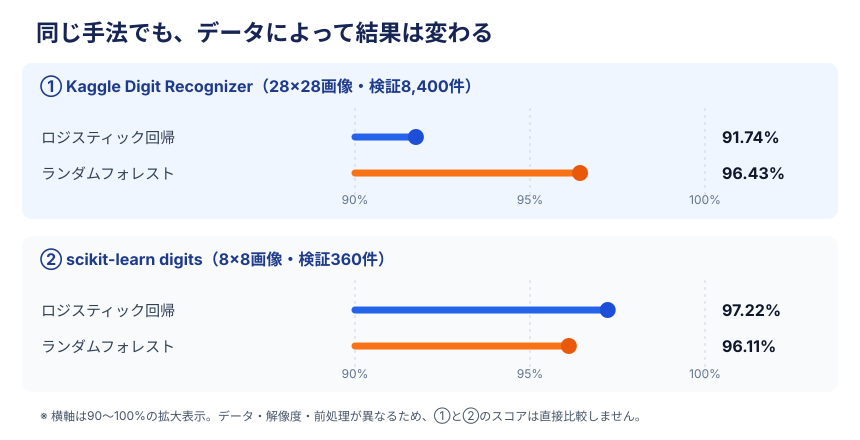

# 木を100本集めたら、手書き数字が読めた ── ランダムフォレストは何が得意なのか？

「この数字は9？ それとも4？」

人間でも迷うような手書き文字を、コンピューターはどう見分けているのでしょうか。Kaggleの手書き数字認識コンペで、**100本の決定木を組み合わせるランダムフォレスト**を試してみたところ、公開リーダーボードで **96.36%** の正解率が出ました。

ところが、別の小さな手書き数字データで試すと、比較対象に選んだ**ロジスティック回帰の方が勝つ**結果になりました。今回はこの逆転をきっかけに、手法の仕組みと実務での使いどころを整理してみます。

> **この記事で分かること**：ランダムフォレストの考え方／ロジスティック回帰との違い／手元で再現する方法／業務データに使う前の注意点。数式を覚える必要はありません。

!!! info "データと数値について"
    前半では [Kaggle Digit Recognizer の自身の実験記録](https://github.com/kumakit/kaggle/blob/main/001_digit-recognizer/learning-log.md) を取り上げます。後半の再現実験には、**別の公開データ**（scikit-learnに同梱されている8×8の手書き数字）を使います。**2つのデータセットは性質が異なるため、正解率を直接比べて優劣を判断してはいけません。** なお、Kaggleの元データや社内データは記事に転載していません。

## 1. Kaggleで何が起きた？

挑戦したのは、28×28ピクセルの画像から0〜9の数字を当てる [Digit Recognizer](https://www.kaggle.com/competitions/digit-recognizer) です。

同じ **8,400件の検証用画像** を使って、2つの手法を比べました。

| 方法 | 検証正解率 | 誤答（8,400件中） |
|:---|---:|---:|
| ロジスティック回帰 | **91.74%** | 694件 |
| ランダムフォレスト（100本） | **96.43%** | 300件 |

**差は4.69パーセントポイント、誤答は394件も少ない**という結果でした。ランダムフォレスト単独で提出したKaggle公開リーダーボードのスコアも **96.36%** に達しています。ただし、公開スコアは提出データの公開評価部分に基づくものなので、未知のデータに対する性能まで保証されるわけではありません。

では、なぜ決定木をいくつも集めると数字を読めるようになるのでしょうか。

## 2. ランダムフォレストを「木」と「森」で理解する

**決定木**は、質問を繰り返しながら答えを絞り込む仕組みです。たとえば手書き数字なら、次のような質問を順番にたどっていきます。

- 画像の右上は黒っぽいか？
- 中央のピクセルは明るいか？
- 左下のあたりにも線がありそうか？

こうした条件分岐を何度も重ねて、最後に「これは9だろう」と判断します。ピクセルの数値に応じた分岐ができるため、直線1本では分けにくい組み合わせも扱えます。

ただし、**1本の決定木は、学習用データの細かな癖まで覚え込んでしまいやすい**のが弱点です。そこでランダムフォレストでは、学習データを復元抽出したサンプルを使ったり、分岐のたびに候補となる特徴量をランダムに絞ったりしながら、個性のある木を何本も育てます。

1本の木が「9」と答えても、別の木は「4」と答えるかもしれません。**複数の木の判断を持ち寄ることで、1本の木の偶然の偏りに振り回されにくくする**のが狙いです。厳密に言うと、今回使うscikit-learnの分類器では、各木が出した予測確率を平均して最終的なクラスを決めています。

一方のロジスティック回帰は、各ピクセルの値に重みを掛けて足し合わせ、クラスを判定する**線形の分類モデル**です。「回帰」という名前がついていますが、ここで予測するのは数値の大小ではなく、0〜9のどのクラスに当てはまるかです。シンプルで速く、どのピクセルが効いているかも係数から追いやすい反面、特徴量同士の複雑な組み合わせをそのまま表現するのは得意ではありません。

!!! tip "100本にすれば必ず良くなる？"
    いいえ。木を増やすほど計算量は増えますし、データの性質によっては別の手法の方が良い結果になります。まずはシンプルな比較から始めるのが近道です。

## 3. 5分で再現：別の数字データで比較してみる

ここからはKaggleのCSVをダウンロードせずに手元で実験します。scikit-learnの `load_digits` には、**8×8ピクセル・1,797件** の手書き数字データがあらかじめ入っています。前半の28×28画像とは別のデータセットです。

[再現用スクリプト](https://github.com/kumakit/bearworks-docs/blob/main/scripts/compare_digit_models.py) を使えば、2つのモデルを同じ訓練・検証データの分割で比べられます。リポジトリのルートから、[uv](https://docs.astral.sh/uv/) を使って実行してみてください。

~~~bash
uv run --no-project --with scikit-learn==1.8.0 python scripts/compare_digit_models.py
~~~

スクリプトの中では、まずデータを **学習80%・検証20%** に分けます。分割が毎回同じになるよう `random_state=42` を固定し、各数字の割合をおおむね保つように `stratify=y` を指定しています。ロジスティック回帰には学習データだけから計算した標準化を掛け、ランダムフォレストには元の特徴量をそのまま渡しています。

手元の **Python 3.13.5 / scikit-learn 1.8.0** 環境で動かした結果は次の通りでした。

| 方法 | 検証正解率 | 誤答（360件中） |
|:---|---:|---:|
| ロジスティック回帰 | **97.22%** | 10件 |
| ランダムフォレスト（100本） | **96.11%** | 14件 |

**今度はロジスティック回帰が1.11パーセントポイント上回りました。**

Kaggleでの実験とは、ちょうど逆の結果です。とはいえ、これは矛盾ではありません。画像の解像度や件数、特徴量の分布、前処理、モデル設定といった条件がそもそも違うからです。この小さな実験だけで「どちらが一般的に優れているか」を決めつけることはできません。4件の誤答差を過大に見積もらず、実務では複数の分割や運用条件で確かめる必要があります。

**ここが一番伝えたい点です。** 機械学習で身につけるべきなのは「どのアルゴリズムが最強か」という順位表ではなく、**同じ条件で比べて、外れた例から理由を考える**姿勢だと思います。

## 4. 失敗しやすい例：正解率だけを信用する

手書き数字では各クラスが比較的均等なので、正解率は結果を理解するのに便利でした。しかし、業務データではそううまくいくとは限りません。

たとえば、問い合わせのうち「緊急案件」が1%しかないケースを考えてみます。すべてを「通常」と答えるだけのモデルでも、**正解率は99%** になります。これでは緊急案件を1件も拾えないため、業務では使いものになりません。

こうした場面では、少なくとも **再現率（緊急案件をどれだけ見つけられたか）** と **適合率（緊急と判定したうち何件が本物だったか）** を確認しましょう。誤判定したときの業務コストによって、重視する指標も変わってきます。

また、標準化や特徴量の作成を**検証データも含めた全体に対して先に行う**と、未来や未知の情報を覗き見てしまう「データリーク」につながることがあります。再現スクリプトでは、標準化を `Pipeline` に組み込み、**学習データだけで変換ルールを学ぶ**形にしています。受付日時を持つデータなら、ランダムに分割するのではなく時系列に沿って検証すべきケースもあります。

## 5. 仕事ではどこに使える？

社内SEやデータ分析の業務に引き寄せて考えると、ランダムフォレストはたとえば次のような**分類タスク**で、初期に検討する候補の一つになります。

| 業務課題 | 予測したいこと | 先に考える注意点 |
|:---|:---|:---|
| 問い合わせの仕分け | 問い合わせカテゴリ | 正解ラベルの品質、誤分類したときの手戻り |
| CSV連携エラーの一次切り分け | エラー種別 | エラー発生後にしか分からない値を特徴量に混ぜない |
| 定型的な確認作業の優先順位付け | 要確認／通常 | 見逃しコスト、少数クラスの評価 |

なお、これらは**活用イメージの例**であり、実際の業務データで検証した結果ではありません。テキストを扱う場合は数値特徴量へ変換する工夫も要ります。また、「問い合わせが増えそうか」を当てる**予測**と、「施策によって問い合わせが減ったか」を確かめる**因果効果の検証**は別の問いである点も押さえておきたいところです。

反対に、データが極端に少ない場合や、予測することよりもルールの明文化が大事な場合、判断理由を厳格に説明しなければならない場面では、まず単純なルールベースやロジスティック回帰から検討した方がよいこともあります。機密情報や個人情報を含む実データを公開Notebookや公開リポジトリへ載せてはいけません。

## 6. 次の実験で使う5つのチェック

- [ ] **何を予測するか**を一文で言えるか？
- [ ] **予測する時点で分かる情報だけ**を使っているか？
- [ ] **同じ検証データと指標**で、シンプルな手法と比較したか？
- [ ] 正解率だけでなく、**間違えた事例や見逃し**を確認したか？
- [ ] 「なぜこのモデルを使うのか」と「使わない条件」を説明できるか？

ランダムフォレストの強みは、深層学習をいきなり持ち出さなくても、比較のベースラインを手早く作れるところにあります。**比べてみた結果として負けることも、次の判断につながる大切な収穫**です。

次は「ロジスティック回帰はいったい何を見て数字を判断しているのか？」を、係数の可視化から掘り下げてみると理解がさらに深まりそうです。

---

## 出典・再現情報

- [Kaggle Digit Recognizer（公式）](https://www.kaggle.com/competitions/digit-recognizer)
- [今回のKaggle実験ログと比較スクリプト](https://github.com/kumakit/kaggle/tree/main/001_digit-recognizer)
- [scikit-learn: RandomForestClassifier](https://scikit-learn.org/stable/modules/generated/sklearn.ensemble.RandomForestClassifier.html)
- [scikit-learn: LogisticRegression](https://scikit-learn.org/stable/modules/generated/sklearn.linear_model.LogisticRegression.html)
- [scikit-learn: load_digits](https://scikit-learn.org/stable/modules/generated/sklearn.datasets.load_digits.html)
- [scikit-learn: よくある落とし穴（データリーク）](https://scikit-learn.org/stable/common_pitfalls.html)

*作成：2026-11-22／関連Issue： [記事化 #439](https://github.com/kumakit/mission-control/issues/439)・[Kaggle学習 #402](https://github.com/kumakit/mission-control/issues/402)*
