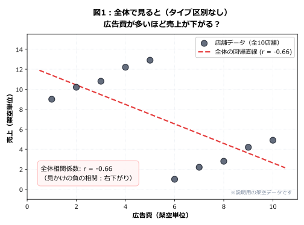
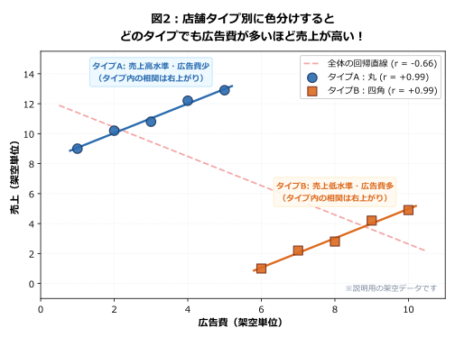
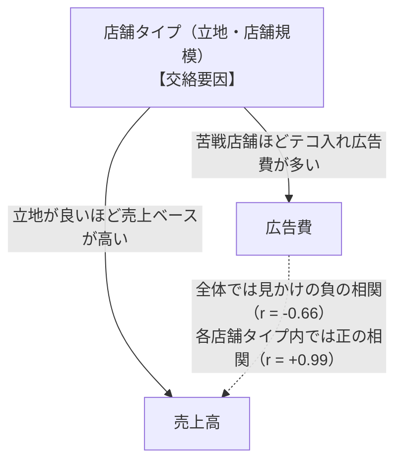

# 数字は正しいのに結論が逆転？ シンプソンのパラドックス

> 「広告費を増やすほど売上が下がる」。散布図はそう語っていた。ところが店舗タイプごとに色分けすると、どのタイプでも広告費が多いほど売上が高かった。どちらのグラフが正しいのだろう？

データ分析や統計の現場で、誰もが一度は混乱に陥る現象があります。それが**「シンプソンのパラドックス（Simpson's Paradox）」**です。

全体のデータをまとめて集計したときに見られる傾向（相関関係や平均の大小）が、データをグループ別に分けて（層別して）分析すると**正反対の結果に逆転してしまう**現象を指します。

「誰かが計算ミスをしたのか？」「データを改ざんしたのか？」と疑いたくなりますが、**どちらの数字も数学的には完全に正しい**のです。なぜこのような不思議な逆転が起きるのか、具体的な図と身近な例で紐解いていきましょう。

---

## 1. 冒頭クイズ：広告費を増やすべきか、減らすべきか？

まず、ある小売チェーンの「店舗ごとの広告宣伝費」と「売上高」をプロットした散布図をご覧ください（10店舗の架空データ）。

全体の相関係数は **$r = -0.66$**（強い負の相関）。回帰直線の傾きも明確な右下がりです。

このグラフだけを見せられた経営陣は、きっとこう言うでしょう。

> 「広告費をかければかけるほど、なぜか売上が落ちているじゃないか！ 今すぐ全店の広告予算を削るべきだ！」

果たして、この判断は正しいのでしょうか？

---

## 2. 種明かし：店舗タイプ別に色分けしてみる

では、**まったく同じ10店舗のデータ点**を、店舗の業態（「タイプA：都心大型店」「タイプB：郊外小型店」）ごとに色分けしてみます。

色分けした瞬間、驚くべき事実が見えてきます。

- **タイプA（青）:** 相関係数 **$r = +0.99$**（非常に強い右上がり）
- **タイプB（橙）:** 相関係数 **$r = +0.99$**（非常に強い右上がり）
- **全体（薄い破線）:** 相関係数 **$r = -0.66$**（右下がり）

なんと、タイプAでもタイプBでも、**「広告費を増やすほど売上も伸びている」**のです！

全体では「右下がり」だった関係が、グループ別に見るとどちらも「綺麗な右上がり」に逆転してしまいました。

---

## 3. 逆転の仕組み：なぜこんなことが起きるのか？

なぜこのような逆転が起きるのでしょうか。その鍵を握るのが、店舗タイプという**「第3の変数（交絡要因）」**です。

1. **タイプA（都心大型店）:**
   もともとの集客力・売上ポテンシャルが非常に高い（売上9〜13）。そのため、比較的少ない広告費（1〜5）でも高い売上を達成できます。
2. **タイプB（郊外小型店）:**
   もともとの店舗規模が小さく売上ベースが低い（売上1〜5）。集客に苦戦しているため、テコ入れとして広告費を多く投入（6〜10）していますが、売上そのものは大型店に届きません。

この2つのグループをタイプを無視してひとまとめにすると、**「広告費が少なく売上が高いタイプA」**と**「広告費が多く売上が低いタイプB」**という2大クラスターが結ばれ、全体として見かけ上の右下がり（負の相関）が作り出されてしまったのです。

### 全体とグループ別、どちらが「間違い」なのか？

ここで最も重要なのは、**「全体の集計も、タイプ別の集計も、どちらも間違いではない」**ということです。両者はそれぞれ**「異なる問い」に答えています**。

| 視点 | 答えている問い | 読み取れる事実 |
|:--|:--|:--|
| **全体の分析** | 「チェーン全体として、広告費を多く使っている店舗は売上が高いか？」 | 事実として、広告費が多い店舗ほど売上が低い（苦戦店舗に広告費が集中しているというマクロな実態）。 |
| **グループ別の分析** | 「同じタイプの店舗において、広告費を増やしたときに売上はどう動いているか？」 | どちらのタイプでも、広告費が多い店舗ほど売上は高い（グループ内のミクロな関係）。 |

!!! warning "相関から因果への飛躍に注意"
    グループ別の相関が $+0.99$ だからといって、「広告費を増やせば必ず売上が増える」という**因果関係を直ちに断定することはできません**。このデータは観察データであり、「売上が伸びそうな施策や季節に合わせて広告費を増やした」という逆の因果や、他の未測定の要因（店長のスキル、品揃えなど）が影響している可能性があるからです。

---

## 4. 別の驚き：病院の治療成功率（割合の逆転）

シンプソンのパラドックスは、散布図だけでなく**クロス集計表（比率・割合）**でも日常的に発生します。

医療の現場を模した有名な架空例を見てみましょう。新しい治療法を採用したA病院とB病院の患者100人ずつのデータです。

### 軽症・重症別の治療成功率（架空データ）

| 重症度 | 病院 | 成功数 | 患者数 | 成功率 |
|:---|:---|---:|---:|---:|
| **軽症** | A病院 | 72 | 80 | 90.0% |
| **軽症** | B病院 | 19 | 20 | **95.0%** |
| **重症** | A病院 | 4 | 20 | 20.0% |
| **重症** | B病院 | 24 | 80 | **30.0%** |
| **全体** | **A病院** | **76** | **100** | **76.0%** |
| **全体** | **B病院** | **43** | **100** | **43.0%** |

この表をじっくり眺めてみてください。

- **軽症患者:** A病院は90%に対し、**B病院は95%**（B病院の勝ち）
- **重症患者:** A病院は20%に対し、**B病院は30%**（B病院の勝ち）

軽症でも重症でも、**どちらの患者層でもB病院の方が治療成功率が高い**のです。

ところが、病院全体の合計を見ると：

- **全体成功率:** **A病院は76.0%** に対し、**B病院は43.0%**（A病院の圧勝!?）

グループ別ではB病院が勝っていたのに、全体を集計するとA病院が大逆転してしまいました。

### 数式で見る逆転の理由：構成比の違い

全体の成功率は、各層の成功率を「患者の構成比」で加重平均した値です。

$$
\text{全体成功率} = \sum (\text{各層の成功率} \times \text{その層の患者割合})
$$

それぞれの計算式を展開してみます。

- **A病院:**
  $$
  90\% \times \underbrace{\frac{80}{100}}_{\text{軽症 80\%}} + 20\% \times \underbrace{\frac{20}{100}}_{\text{重症 20\%}} = 72\% + 4\% = \mathbf{76.0\%}
  $$
- **B病院:**
  $$
  95\% \times \underbrace{\frac{20}{100}}_{\text{軽症 20\%}} + 30\% \times \underbrace{\frac{80}{100}}_{\text{重症 80\%}} = 19\% + 24\% = \mathbf{43.0\%}
  $$

A病院は治りやすい**軽症患者が全体の8割**を占めているため、全体の成功率が大きく引き上げられています。
一方、B病院は高度医療センターとして**助かりにくい重症患者を全体の8割**受け入れているため、全体の成功率が見かけ上低くなっているのです。

---

## 5. 読者の疑問に答える：A病院は優秀ではないのか？

この例を読むと、多くの方が次のような疑問を持ちます。

### 疑問1：「実際に76%治しているのだから、A病院の方が社会的に優秀では？」

**回答:**
「実際に受け入れた患者の中で何割を救命できたか」という**実績の記述**としては、A病院が76%でB病院が43%であることは紛れもない事実です。もし地域の医療計画で「受け入れ総数に対する退院実績」を把握したいなら、この全体値が必要です。

しかし、「自分がもし病気にかかったら、どちらの病院に入院したいか？」という**治療選択の判断**では話が変わります。軽症であっても重症であっても、条件をそろえた層別比較ではB病院の方が成功率が高いからです。

### 疑問2：「共通の患者構成比にそろえたらどうなる？（標準化）」

もし両病院が「軽症50%・重症50%」という同じ患者構成を受け入れたと仮定（**標準化**）して比較するとどうなるでしょうか。

- **A病院（標準化）:** $90\% \times 0.5 + 20\% \times 0.5 = 45\% + 10\% = \mathbf{55.0\%}$
- **B病院（標準化）:** $95\% \times 0.5 + 30\% \times 0.5 = 47.5\% + 15\% = \mathbf{62.5\%}$

構成比をそろえると、B病院の成功率（62.5%）がA病院（55.0%）を上回ります。

!!! note "標準化の重み付けは対象集団による"
    ここでは分かりやすく50:50としましたが、標準化で用いる構成比（重み）は分析目的や想定する患者母集団の比率に応じて定めます。「どの重みを採用するか」によって算出される値は変わる点に留意してください。

---

## 6. 層別化も万能ではない：「軽症・重症」の線引きは曖昧

「じゃあグループ分け（層別化）さえすれば、いつでも正しい答えが出るのか？」というと、実はそうとも言えません。

1. **層内の異質性（残余交絡）:**
   同じ「重症」というカテゴリの中でも、B病院は「生命維持装置が必要な最重症」、A病院は「中等症に近い重症」ばかりを受け入れているかもしれません。分類が粗いと、層の中に隠れた偏りが残ってしまいます。
2. **境界線の曖昧さ:**
   軽症と重症の判定基準が主観的であったり、病院ごとに診断基準が異なれば、それ自体が選択バイアス（測定バイアス）を生みます。
3. **未測定の交絡因子:**
   年齢、基礎疾患、来院までの経過時間など、記録されていない別の要因が結果を左右している可能性は常に残ります。

交絡に対処するには、カテゴリ分けによる層別化だけでなく、連続変数として重回帰分析で調整したり、傾向スコアを用いた分析などの手法が存在しますが、**「どんな手法で統計的調整を行っても、観察データから完全な因果関係を立証したことにはならない」**という原則を常に意識する必要があります。

### 混同しやすい統計用語の整理

| 用語 | 意味 | 本記事での該当例 |
|:--|:--|:--|
| **疑似相関（みかけの相関）** | 第3の交絡要因のせいで、本来は無関係または逆向きの2変数間に相関があるように見えること。 | 広告費が多いほど売上が低く見えた現象（原因は店舗タイプ）。 |
| **交絡（Confounding）** | 原因と結果の双方に影響を与え、両者の関係を歪める第3の要因のこと。 | 「店舗タイプ」や「患者の重症度」。 |
| **偏相関係数（Partial correlation）** | 量的変数において、第3の変数の影響を取り除いた（コントロールした）上で計算する2変数間の相関係数。 | 店舗面積や客数などの量的交絡の影響を除いた広告費と売上の相関。 |
| **標準化（Standardization）** | 構成比の違いによる歪みを補正するため、共通の基準集団の割合を掛けて加重平均すること。 | 軽症50%・重症50%にそろえた病院成功率の再計算。 |

---

## 7. 実務でよくあるシンプソンのパラドックス

シンプソンのパラドックスは、ビジネス現場のKPI管理でも頻繁に罠を仕掛けてきます。

### 実務例：カスタマーサポートの「平均対応時間」

> 「問い合わせ窓口に自動チャットボットを導入した。ところが翌月、オペレーターの**1件あたり平均対応時間が10分から14分へと悪化**してしまった！ チャットボットは失敗だったのか？」

これもシンプソンのパラドックスです。

- **導入前:** 簡単なパスワードリセット（3分で解決）が70%、複雑な技術トラブル（20分かかる）が30%だった。全体平均は $3 \times 0.7 + 20 \times 0.3 = 9.1$ 分。
- **導入後:** 簡単な質問はすべてチャットボットが自己解決するようになった。その結果、オペレーターには「複雑な技術トラブル」だけが集中（90%）するようになり、同じトラブルへの対応時間が18分に短縮（効率化）されていたとしても、全体平均は $3 \times 0.1 + 18 \times 0.9 = 16.5$ 分に跳ね上がる。

個別の難易度別で見ればオペレーターの対応スピードは向上しているのに、**「難易度の構成比」が変化したために全体平均が悪化して見えた**のです。

---

## 8. 統計検定2級での出題ポイント

統計検定2級の試験対策として、シンプソンのパラドックスに関連する出題テーマを押さえておきましょう。

※公式シラバスに「シンプソンのパラドックス」という固有名称が明記されているわけではありませんが、出題範囲である「散布図の読み取り」「相関と疑似相関」「クロス集計」「回帰分析」の理解を問う問題として深く関係しています。

| 試験テーマ | 出題のされ方・問われる理解 |
|:--|:--|
| **散布図と層別** | 散布図全体では負の相関に見えるが、マークの形や色（カテゴリ）でグループ分けすると各グループ内で正の相関を示す図を読み取らせる問題。 |
| **相関と因果・疑似相関** | 「相関関係があるからといって因果関係があるとは限らない」「第3の共通要因（交絡変数）によって見かけの相関が生じる」という正誤判定。 |
| **偏相関係数** | 変数 $Z$ の影響を除去した後の変数 $X, Y$ の相関。2変数だけの相関（ゼロ次相関）と偏相関で符号が反転するケースの理解。 |
| **分割表と加重平均** | 分割表（クロス集計表）において、周辺度数（合計）の割合と条件付き割合（層別割合）の違いを正しく計算・比較できるか。 |

---

## 9. 理解度チェッククイズ

??? question "Q1. グループ別の相関と全体の相関について、正しい記述はどれ？"
    1. グループ別の相関がすべて正であれば、全体の相関が負になることは数学的にあり得ない。
    2. 全体で負の相関がある場合、グループ別の相関も必ず負になる。
    3. 各グループの相関がすべて正であっても、グループ間の平均値の位置関係によっては全体の相関が負になり得る。

    ??? success "解説・解答"
        **正解は 3 です。**
        各グループの回帰直線が右上がり（正）であっても、グループごとの平均値が「左上にグループA、右下にグループB」のように位置していると、全体の相関は負（右下がり）になります。これがシンプソンのパラドックスの典型例です。

??? question "Q2. シンプソンのパラドックスが発生しているとき、全体の集計はどう評価すべき？"
    1. 全体の集計は計算方法が間違っているので、破棄してグループ別データのみを使うべきである。
    2. 全体の集計も集計結果としては正しく、知りたい問い（マクロな実態か、グループ内の関係か）によって使い分けるべきである。
    3. グループ別の集計はサンプルサイズが小さくなるため、常に全体の集計を正として採用すべきである。

    ??? success "解説・解答"
        **正解は 2 です。**
        全体集計は「全体としてのマクロな実態」を正しく表しており、計算の間違いではありません。「個々の施策の効果や条件をそろえた比較」をしたいのか、「集団全体の実績」を把握したいのか、問いの目的に応じて使い分ける必要があります。

??? question "Q3. 病院の例で重症度別に層別化してB病院の成功率が高かった場合、直ちに言えることは？"
    1. B病院の医師の医療技術がA病院よりも優れていることが科学的に証明された。
    2. 軽症・重症という分類のもとでは各層でB病院の成功率が高いが、これだけで医療技術の因果効果を断定することはできない。
    3. 全体成功率はA病院が高いので、重症度別の分析は意味がない。

    ??? success "解説・解答"
        **正解は 2 です。**
        「軽症・重症」という区分の中にも病状のばらつき（残余交絡）が残っている可能性や、他の交絡因子（患者の年齢や合併症の有無など）が存在しうるため、観察データの層別比較だけで「病院の能力差による因果効果」と断定することはできません。

---

## 10. 明日から使える実務チェックリスト

データ分析で誤った意思決定を下さないために、次のチェックリストを手元に置いておきましょう。

- [ ] **全体だけで判断していないか？**
  散布図や平均値を1つの数字・1枚のグラフだけで見て満足していないか。
- [ ] **重要な属性で「色分け」してみたか？**
  店舗タイプ、顧客ランク、新規/既存、時間帯、地域などの主要カテゴリで層別してみたか。
- [ ] **グループごとの「分母」と「構成比」を確認したか？**
  割合を比較するとき、背後にあるサンプルサイズやグループ構成比が大きく偏っていないか。
- [ ] **その分析が答えようとしている「問い」は何か？**
  「全体の現状把握（記述）」なのか、「条件をそろえた比較」なのか、「施策の効果検証（因果推論）」なのかを混同していないか。

!!! info "似ているけれど異なる落とし穴：「切断効果」との違い"
    本サイトの別記事で解説している[切断効果（データ選択による相関の変化）](truncation-effect.md)も相関が歪む現象ですが、仕組みが異なります。
    
    - **シンプソンのパラドックス:** 複数のグループが混ざり合い、**交絡要因や構成比の違い**によって全体と層別で相関や割合が逆転する。
    - **切断効果:** 特定の合格基準や足切り条件によって**データの一部だけを切り取って選択**した結果、分散が狭まり相関が弱まったり反転したりする。
    
    どちらも実務や統計検定で頻出する罠ですので、あわせて確認しておくと理解が深まります。

---

## 関連記事

- [データ選択による相関の変化（切断効果）](truncation-effect.md) — データを特定基準で切り取ったときに起きる相関の罠
- [2変数記述統計（散布図・相関係数・回帰分析）](bivariate-descriptive-statistics.md) — 散布図と相関係数、分割表の基本
- [統計検定2級 学習用まとめ](statistics_l2.md) — 記述統計から推測統計までの試験対策エッセンス
- [独立と排反を業務で活かす：問い合わせ・障害分析の実例](independence-mutual-exclusivity-in-operations.md) — 確率と集合の考え方

---

## 参考資料・公式出典

- [一般財団法人 統計質保証推進協会 統計検定2級 公式案内](https://www.toukei-kentei.jp/grade/grade2/)
- [統計検定2級 出題範囲表（公式PDF）](https://www.toukei-kentei.jp/hubfs/files/grade_range/grade2_hani_20181214.pdf)
