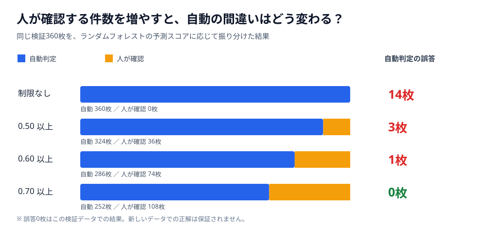
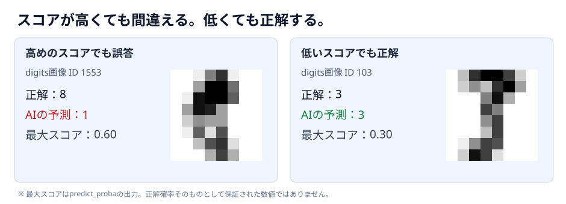

# AIが「自信のない予測」だけ、人間に確認してもらうことはできる？ ── 予測スコアと人の仕事量を実験した

**「この画像は数字の8です。たぶん、かなり自信があります。」**

そう答えたAIが間違っていたら、どうすればいいのでしょうか。

機械学習を仕事に導入するとき、すべてをAI任せにする必要はありません。**AIが判断しやすいものは自動処理し、迷うものだけ人間が確認する**という分担もできます。

では、「AIが迷っている」ことは、どう判断するのでしょうか。今回はKaggleの手書き数字認識から一歩進んで、実際の予測スコアを使った振り分けを試しました。

> **この記事の問い：** 人が確認する件数を増やすと、自動判定の間違いはどこまで減らせるのか？

!!! info "今回使うデータ"
    前回までと同じく、[Kaggle Digit Recognizerでの学び](https://github.com/kumakit/kaggle/blob/main/001_digit-recognizer/learning-log.md)を出発点にしています。ただし**今回の数値と画像はKaggleの28×28画像ではありません**。[scikit-learn付属のdigits](https://scikit-learn.org/stable/modules/generated/sklearn.datasets.load_digits.html)（8×8ピクセル、1,797枚）を使った**別の再現実験**です。社内データは使っていません。

## 1. 「全部AIに任せる」以外の選択肢

前回の[誤答分析（Draft PR #5）](https://github.com/kumakit/bearworks-docs/pull/5)では、手書き数字を分類するモデルが、間違いやすい数字の組み合わせを見つけました。

今回は別の問いです。**間違いそうな画像を、回答する前に人間へ渡せないか？**

やりたいことは、とてもシンプルです。

1. AIが数字を予測する。
2. その予測の**最大スコア**を取得する。
3. スコアが決めた値より低ければ、AIは答えを確定せず**人の確認に回す**。
4. 高ければ、そのままAIの予測を採用する。

この「自信の低いときには自動判定を控える」考え方は、**選択的分類（Selective Classification）**や**棄権（Abstention）**と呼ばれます。

### ただし、スコアは「本当に正しい確率」とは限らない

今回使うランダムフォレストの \`predict_proba\` は、モデルの予測を各数字に振り分けた**確率形式のスコア**を返します。ここでは10クラスのうち**最大の値**を「自信の目安」とします。

たとえば「1：0.60」「8：0.17」「その他の数字：残り」と出ていれば、最もスコアが高い「1」と予測します。

しかし **0.60だから60%の確率で正しい**、とは言い切れません。スコアと実際の正解率の関係を確かめる**確率の校正（Calibration）**が必要になる場合があります。ここでは、スコアを**振り分けのための順位づけ**として使います。

## 2. 「自信が低い」をどう決める？

まずは公開digitsデータを学習用80%・検証用20%に分けます。

- 検証画像：**360枚**
- モデル：**ランダムフォレスト（決定木100本）**
- 何も振り分けない場合：**346枚正解、14枚誤答（96.11%）**

同じ検証用360枚について、最大スコアのしきい値を**0.50／0.60／0.70**と変え、「AIが自動判定する数」と「人が確認する数」を数えました。

たとえば**0.60以上なら自動、それ未満は人が確認**、というルールです。

数字を表にすると、次の通りです。

| 自動判定する条件 | AIが自動判定 | 人が確認 | 自動判定に残った誤答 |
|:---|---:|---:|---:|
| 制限なし | **360枚** | 0枚 | 14枚 |
| 最大スコア ≥ 0.50 | 324枚 | 36枚 | 3枚 |
| 最大スコア ≥ 0.60 | 286枚 | 74枚 | 1枚 |
| 最大スコア ≥ 0.70 | **252枚** | **108枚** | **0枚** |

**0.70を基準にすると、360枚中252枚（70%）をAIが自動判定し、残り108枚（30%）を人に回す**形になります。

さらに、この検証データでは**14枚の誤答がすべて人の確認対象に入り、自動判定に残った誤答は0枚**でした。

これは魅力的な結果ですが、重要な注意があります。

!!! warning "自動判定の誤答が0枚＝運用全体の正解率100%ではない"
    **この360枚だけの観測結果**です。別の日や別のデータでは、高スコアでも間違えるかもしれません。また人間が確認した108枚を**必ず正しく直せるとは限りません**。人間の確認にかかる時間や、見逃し・判断ミスも別途検証する必要があります。

## 3. AIのスコアを信じすぎてはいけない理由

実際の手書き数字から、対照的な2枚を並べました。

左は、**正解が「8」なのにAIは「1」と予測**した例。最大スコアは**0.60**でした。しきい値が0.60なら、この画像は**人に回されず自動判定されてしまいます**。

右は、**正解が「3」でAIも「3」と予測**した例。ただし最大スコアは**0.30**しかありません。しきい値0.70なら、人に確認してもらう対象になりますが、AIの答えは元から正解でした。

つまり、低スコアの画像を人へ回す方法には、**間違いそうなものを拾える一方、正解しているものも人の仕事にしてしまう**というコストがあります。

0.70を基準にした今回の108枚のうち、**実際の誤答は14枚、元から正解だった画像は94枚**でした。

**人の確認を30%に増やして、14枚の誤答を拾った**。これが今回の結果の正確な読み方です。

## 4. 一番大事なのは「人に回す件数」と「見逃し」のバランス

しきい値を上げれば、確認対象が増えやすくなります。

- **低めのしきい値**：AIの自動処理が多く、人の負担は軽い。ただし誤答が残りやすい。
- **高めのしきい値**：誤答を人へ回しやすい。ただし正解できる画像まで確認対象になりやすい。

では、どの値にすべきでしょうか？

答えは、**業務によって違う**です。

問い合わせの緊急度分類なら、**緊急案件の見逃し**と、**通常案件を誤って緊急扱いすること**の損失を比較する必要があります。たとえば1日20件の問い合わせなら、人が6件確認する運用は可能かもしれません。一方で1日20万件なら、3割の人手確認は実現が難しいでしょう。

正解率よりも、**自動処理率（Coverage）**と**自動処理したものの誤り率（Selective Risk）**をセットで考えると、設計しやすくなります。

!!! tip "本番導入の前に"
    今回の0.50／0.60／0.70は**説明のために固定した比較値**で、最適なしきい値として採用したものではありません。本当に運用するなら、**しきい値を決めるための検証データ**と、**採用後の性能を測る未使用のテストデータ**を分けてください。同じデータを見て都合のよいしきい値を選び、そのまま「本番で誤答ゼロ」と主張するのは危険です。

また、画像の種類や業務状況が変わるとスコアの分布も変わります。**高スコアの誤答・人の処理時間・確認対象の割合**を継続して観察する必要があります。

## 5. 社内SEの仕事に置き換えると？

想像しやすいのは、**問い合わせ分類の一次振り分け**です。

「アカウント」「CSV連携」「ワークフロー」などへ自動分類する場面で、次のように役割を分けます。

| 判定結果 | 処理の例 |
|:---|:---|
| 十分に根拠があり、スコアも高い | 自動でカテゴリ候補を登録する |
| スコアが低い／複数カテゴリが競っている | 担当者の確認キューへ回す |
| セキュリティ事故や重大障害の可能性がある | **スコアにかかわらず**別の明示ルールで優先確認する |

最後の行が大切です。**「自信が高いから安全」とは限りません**。重大な見逃しが許されない業務では、モデルのスコアとは別に安全上のルールが必要です。

さらに、人が確認した結果は、すぐ本番の学習データに自動追加するのではなく、**正しいラベルか、個人情報を含まないか、記録してよいか**を確認してから扱います。

最初から全面自動化を目指すより、**「人の判断を助ける仕組み」から導入する**方が、現場で使い方を考えやすいかもしれません。

## 6. 公開データだけで再現してみる

今回の振り分け表と画像は、公開データだけで作れます。

[再現スクリプト：selective_digit_review.py](https://github.com/kumakit/bearworks-docs/blob/main/scripts/selective_digit_review.py) をリポジトリのルートで実行してください。

~~~bash
uv run --no-project --with scikit-learn==1.8.0 python scripts/selective_digit_review.py
~~~

環境構築用の新しい基盤は作らず、[uv](https://docs.astral.sh/uv/)でscikit-learnを実行時だけ利用する形です。

スクリプトでは同じ条件（\`random_state=42\`、訓練80%・検証20%、木100本）で学習し、しきい値ごとに次の件数を出力します。

- AIが自動判定した件数
- 人の確認に回した件数
- 自動判定に残ってしまった誤答件数
- 人の確認対象に含まれる誤答件数

実行すると、この記事で使った**比較図と実画像のSVG**も出力します。

## 7. 今日の結論：AIに必要なのは「自信」より「保留できる仕組み」

今回の実験で分かったのは、**AIの予測スコアを使えば、人が見るべき候補を一定程度絞れる**ということです。

ただし、スコアは正解の保証ではなく、確認対象には正解の画像も混ざります。導入時には、**確認する人の作業量、取りこぼし、対応優先度**まで含めて設計する必要があります。

「AIに全部やらせる」か「AIを使わない」かの二択にする必要はありません。**迷ったら人に渡す**という出口を用意するだけでも、AIの使い方は変わってきます。

そして次の疑問です。

**そもそも、ランダムフォレストより高精度だったCNNは、なぜ画像を上手に見分けられたのでしょうか？**

KaggleのDigit RecognizerではCNNで**公開スコア99.132%**を記録しました。次回は、CNNの**畳み込み（Convolution）**が画像の「線」や「曲がり」をどう捉えるのかを、図で追ってみたいと思います。

---

## 関連記事・出典

- [第1回：ランダムフォレスト](random-forest-from-kaggle.md)
- [第2回：多項ロジスティック回帰](multinomial-logistic-regression-from-kaggle.md)
- [第3回：機械学習はどこで間違える？（Draft PR #5）](https://github.com/kumakit/bearworks-docs/pull/5)
- [Digit Recognizer：Kaggle実験記録](https://github.com/kumakit/kaggle/blob/main/001_digit-recognizer/learning-log.md)
- [scikit-learn：RandomForestClassifier](https://scikit-learn.org/stable/modules/generated/sklearn.ensemble.RandomForestClassifier.html)
- [scikit-learn：確率の校正](https://scikit-learn.org/stable/modules/calibration.html)
- [scikit-learn：load_digits](https://scikit-learn.org/stable/modules/generated/sklearn.datasets.load_digits.html)

*作成：2026-11-22／関連Issue：[記事化 #439](https://github.com/kumakit/mission-control/issues/439)・[Kaggle実験 #402](https://github.com/kumakit/mission-control/issues/402)*
